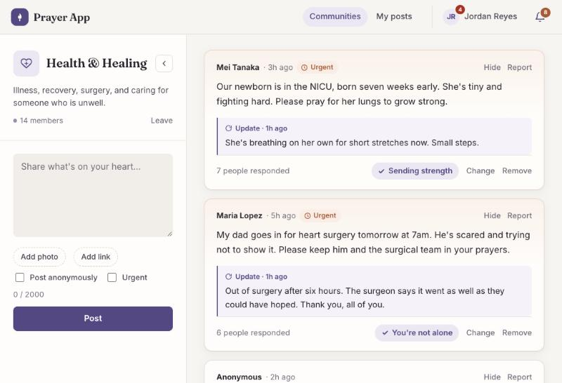
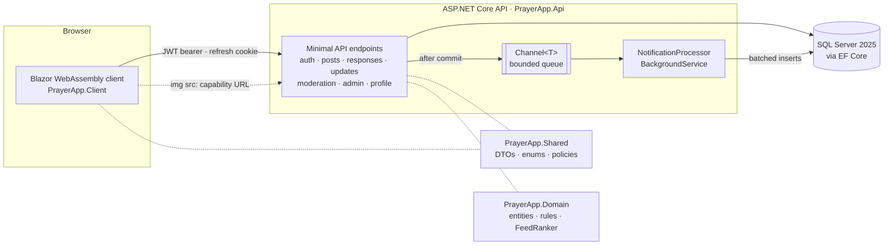
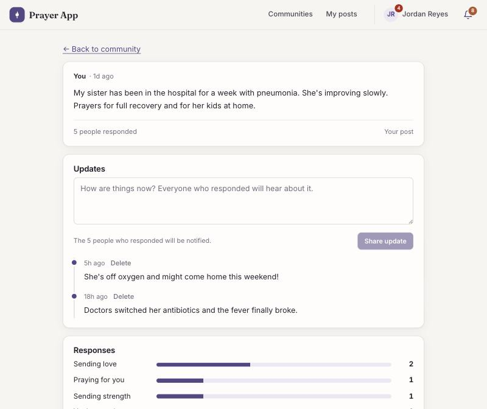
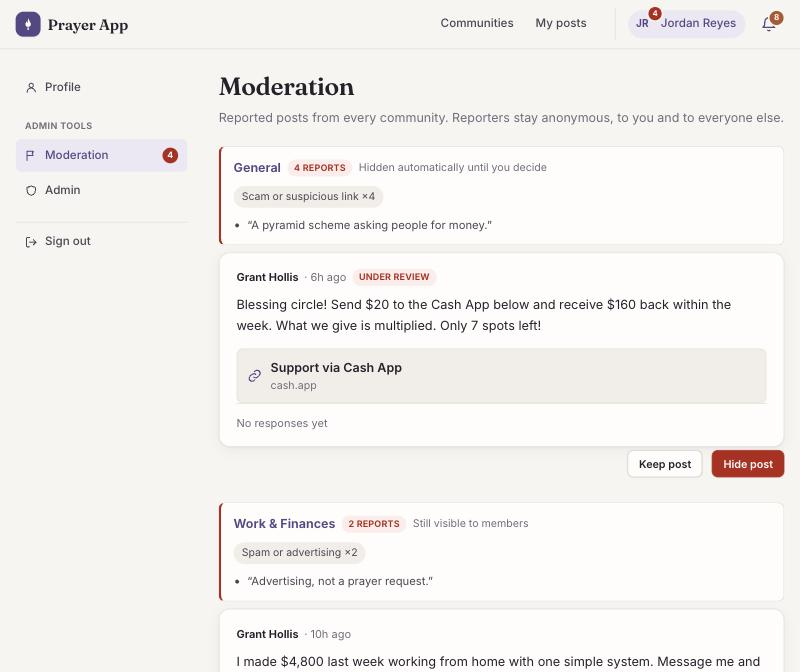
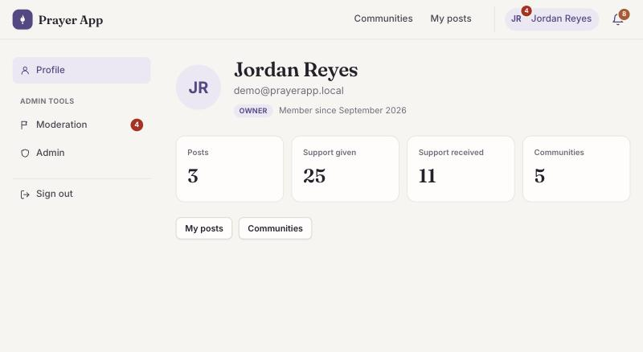
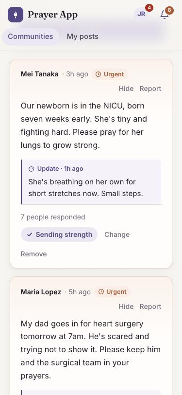

# Prayer App

A cross-faith prayer and support app. People join topical communities, share what they're
carrying, and others respond with a small set of preset responses. Authors post updates so
the people who prayed hear how it turned out, and admins keep the space safe.



**Stack:** ASP.NET Core 10 minimal APIs · Blazor WebAssembly · EF Core · SQL Server 2025 ·
ASP.NET Core Identity + JWT · xUnit + Testcontainers · GitHub Actions

## What it does

- **Communities and a ranked feed.** Seven topical communities. Each feed balances recency,
  the last 24 hours of support, and urgency, and pages through with Load more.
- **Posts with a photo and a link.** Optional anonymity, an urgent flag that stands out
  gently for 48 hours, one photo, and one https link (a fundraiser or Cash App) labeled by
  platform with its real domain shown.
- **Responses that fit the moment.** Support responses for hard times, celebration
  responses for gratitude and answered prayers. Change or withdraw yours at any time.
  Authors see how many people responded and how, never who.
- **Updates.** Authors add follow-ups ("Out of surgery, it went well"), and everyone who
  responded is notified.
- **Notifications** grouped per post behind a bell with an unread count.
- **Reporting and moderation.** Members report posts; three reports hide a post until an
  admin reviews it. Admins work a queue across every community and keep or hide posts.
- **Two roles: user and admin.** Admins moderate and manage other admins from their
  profile. Owners set in configuration can never be removed, so the app can't lock itself out.

## Engineering highlights

Each links to the code and the tests that prove it.

| | Code | Tests |
|---|---|---|
| Feed ranking with top-k selection on a bounded min-heap, O(N log k) | [`FeedRanker.cs`](src/PrayerApp.Domain/Ranking/FeedRanker.cs) | [`FeedRankerTests`](tests/PrayerApp.Tests/Domain/FeedRankerTests.cs) |
| Stable cursor pagination while scores change mid-scroll, with no server state | [`FeedCursor.cs`](src/PrayerApp.Api/Common/FeedCursor.cs), [`PostEndpoints.cs`](src/PrayerApp.Api/Posts/PostEndpoints.cs) | [`RankedFeedTests`](tests/PrayerApp.Tests/Integration/RankedFeedTests.cs) |
| Rotating refresh tokens in an httpOnly cookie, with reuse (theft) detection | [`RefreshTokenService.cs`](src/PrayerApp.Api/Auth/RefreshTokenService.cs) | [`AuthFlowTests`](tests/PrayerApp.Tests/Integration/AuthFlowTests.cs) |
| Race-safe counters: one response per user, counter always equal to its rows | [`AcknowledgmentEndpoints.cs`](src/PrayerApp.Api/Acknowledgments/AcknowledgmentEndpoints.cs) | [`AcknowledgmentTests`](tests/PrayerApp.Tests/Integration/AcknowledgmentTests.cs) |
| Async notification pipeline (`Channel<T>` + `BackgroundService`), batched and idempotent | [`NotificationProcessor.cs`](src/PrayerApp.Api/Notifications/NotificationProcessor.cs) | [`NotificationTests`](tests/PrayerApp.Tests/Integration/NotificationTests.cs) |
| Fan-out on write: one `INSERT … SELECT` notifies every supporter, atomically | [`PostUpdateEndpoints.cs`](src/PrayerApp.Api/Posts/PostUpdateEndpoints.cs) | [`PostUpdateTests`](tests/PrayerApp.Tests/Integration/PostUpdateTests.cs) |
| Auto-hide that still triggers when reports arrive at the same moment | [`ModerationEndpoints.cs`](src/PrayerApp.Api/Moderation/ModerationEndpoints.cs) | [`ModerationTests`](tests/PrayerApp.Tests/Integration/ModerationTests.cs) |
| Admin checks against the database, not the token, and a lock that prevents zero admins | [`AdminAuthorization.cs`](src/PrayerApp.Api/Admin/AdminAuthorization.cs), [`AdminEndpoints.cs`](src/PrayerApp.Api/Admin/AdminEndpoints.cs) | [`AdminTests`](tests/PrayerApp.Tests/Integration/AdminTests.cs) |
| Private images through unguessable URLs; formats detected from the bytes | [`PostImageEndpoints.cs`](src/PrayerApp.Api/Posts/PostImageEndpoints.cs), [`ImageFormats.cs`](src/PrayerApp.Api/Common/ImageFormats.cs) | [`PostImageTests`](tests/PrayerApp.Tests/Integration/PostImageTests.cs) |
| Link validation against `javascript:`, `user@host` tricks and lookalike domains | [`PostLinks.cs`](src/PrayerApp.Shared/Contracts/Posts/PostLinks.cs) | [`PostLinksTests`](tests/PrayerApp.Tests/Shared/PostLinksTests.cs) |

135 tests, including integration tests against a real SQL Server started by Testcontainers.
CI builds with warnings as errors, runs every test, and fails if a model change is missing
its migration.

## Architecture



The client and API share one copy of the rules that both sides need (which responses fit
which post, link validation, size limits) through `PrayerApp.Shared`, so a button the client
shows and a request the API accepts can't disagree. `PrayerApp.Domain` holds entities and
pure logic such as the ranker, with no EF Core or web dependencies, so it's unit-tested in
isolation.

## Screenshots

| Post with updates | Moderation queue |
|---|---|
|  |  |

| Profile | Phone |
|---|---|
|  |  |

## Design notes

**Feed ranking** ([`FeedRanker.cs`](src/PrayerApp.Domain/Ranking/FeedRanker.cs)). Each
active or answered post is scored

```
score = (VelocityWeight × (responses in last 24h + 1) + UrgencyWeight × urgent) / (age hours + 2) ^ Gravity
```

so posts rise with recent support, urgency gives a head start that decays like everything
else, and age pulls everything down. The page is selected with a bounded min-heap that
holds only the best k posts seen so far: O(N log k) time and O(k) memory, instead of sorting
all N candidates. Weights live under `Ranking` in `appsettings.json`.

**Stable pagination over changing scores.** Every page of one scroll session is ranked *as
of* the instant the first page was requested; that timestamp travels in the cursor, and only
posts and responses that existed then count. The ranking is reproducible from the database,
so page N+1 is simply "everything ranked after the last post shown": no duplicates or gaps
when scores shift mid-scroll, and no server-side session state.

**Consistency under concurrency.** A response row and its post's counter commit in one
transaction, with the increment done in SQL (`count = count + 1`) to avoid lost updates. A
unique index on (post, user) is the final guard against double taps. Removing a response
decrements only if the `DELETE` actually removed a row, so ten simultaneous removes
decrement once.

**Notifications, two ways.** Response notifications are enqueued after commit on a bounded
in-process `Channel<T>`, drained in batches by a hosted `BackgroundService` with retry and
exponential backoff. The writer skips responses withdrawn before it ran and duplicate
events, so processing the same event twice still produces one row. Post updates take the
other path, fan-out on write: the update and a notification for every current supporter are
inserted in one transaction by a single `INSERT … SELECT`, one round trip whether three
people responded or three thousand.

**Moderation.** A post's moderation status is separate from its author's status, so an
answered post can be hidden and comes back answered. At three open reports a post is hidden
pending review. That check is a conditional `UPDATE` run *after* the report commits: inside
the report's transaction, simultaneous reports would either deadlock on each other's rows or
each count only themselves and never cross the threshold. Reporters are never revealed, and
a reporter isn't told whether their report triggered the hide. A filtered index covers only
open reports, so the queue stays fast as resolved reports pile up.

**Roles.** Admin is an ASP.NET Core Identity role, or an owner email in configuration. The
`Admin` authorization policy checks the database on every request instead of trusting a role
claim in the 15-minute JWT, so a demoted admin loses access on their next request. Admins
can't demote themselves, and every role change first takes a lock on the single Admin role
row, so two admins demoting each other at the same instant can't leave the app with none.

**Private images.** An `` tag can't send a bearer token held in memory, so images are
served at unguessable URLs (`/images/{random GUID}`) that are only handed to people who can
see the post: a capability URL, like a signed S3 link. Archiving, hiding or replacing a post's
image turns the old URL off. The browser resizes and re-encodes photos before upload, which
also strips location metadata, and the server identifies formats from their first bytes,
refusing anything but JPEG, PNG and WebP (SVG can carry script).

**Privacy by construction.** Anonymous authors' names are removed inside the SQL projection,
so they never leave the database for other viewers. Authors see response counts, never
names. Reporter and admin identities are kept for accountability but never returned.

## Running locally

Prerequisites: [.NET 10 SDK](https://dotnet.microsoft.com/download) and
[Docker Desktop](https://www.docker.com/products/docker-desktop/)
(on Apple Silicon, enable *Use Rosetta for x86/amd64 emulation*).

1. **Start SQL Server**
   ```bash
   cp .env.example .env        # then set a strong SA_PASSWORD
   docker compose up -d
   ```

2. **Give the API its secrets** (stored outside the repo via user secrets)
   ```bash
   dotnet user-secrets set "ConnectionStrings:Default" \
     "Server=localhost,1433;Database=PrayerApp;User Id=sa;Password=<SA_PASSWORD>;TrustServerCertificate=True;Encrypt=True" \
     --project src/PrayerApp.Api
   dotnet user-secrets set "Jwt:SigningKey" "$(openssl rand -base64 64)" --project src/PrayerApp.Api
   ```

3. **Run** (two terminals)
   ```bash
   dotnet run --project src/PrayerApp.Api --launch-profile http      # http://localhost:5160
   dotnet run --project src/PrayerApp.Client --launch-profile http   # http://localhost:5137
   ```
   In Development the API applies migrations on startup, so there's no separate database step.

4. **Optional: make your own account an owner** (an admin who can't be removed). Index 0 is
   already the demo user in `appsettings.Development.json`, so add yours at index 1:
   ```bash
   dotnet user-secrets set "Admin:Emails:1" "you@example.com" --project src/PrayerApp.Api
   ```

## Demo data

In Development the API seeds sample users, posts, responses, updates and reported posts on
first start (`Demo:SeedOnStartup` in `src/PrayerApp.Api/appsettings.Development.json`), so the
app opens onto a living feed and a moderation queue with something in it. Sign in at
http://localhost:5137 with:

| Email | Password |
|---|---|
| `demo@prayerapp.local` | `PrayerDemo2026` |

The demo user is an owner, so it sees Moderation and Admin under its profile. Sixteen other
demo users (`maria@`, `james@`, `priya@`, `hana@`, `elena@`, `marcus@` and more, all
`@prayerapp.local`) share the password, which makes it easy to try both sides of a flow in two
browser windows. Seeding is idempotent and comes in waves, so pulling a newer version adds
its new demo content to an existing database without a reset.

To fill your own registered accounts with posts and responses too, list them under
`Demo:PersonalAccounts` in user secrets. To start over: `docker compose down -v && docker
compose up -d`, then restart the API.

## Known limitations

- Response notifications queued in memory are lost if the API restarts. An outbox table or a
  broker would make them durable. (Update and moderation notifications are written in their
  own transactions and aren't affected.)
- A notification batch that keeps failing is dropped after three attempts and logged; there's
  no dead-letter store.
- The bell polls every 30 seconds and the moderation count every 60; SignalR would make both live.
- The ranked feed considers the newest 500 posts from the last 30 days per community. My
  posts returns at most 100, the moderation queue 50 and the admin user search 50, without paging.
- Images are stored in SQL Server, fine at this scale; larger deployments would move them to
  blob storage behind a CDN.
- Posting with a photo is two requests (create, then upload). If the upload fails the post
  still exists, and the composer says so.
- A response withdrawn in the instant between the notification writer's check and its insert
  can leave one stray notification.
- Login responds slightly faster for unknown emails, and registration reveals whether an
  email is taken (account enumeration).
- Two tabs refreshing the session at the same instant look like token theft and sign the user out.
- Owners are set only in configuration, and there's no screen listing posts an admin hid
  without any reports.
- The Blazor client has no automated UI tests; it's verified by hand in the browser.
- Locally the API connects as `sa`; a least-privilege SQL login would be better.

## Tests

```bash
dotnet test
```

Docker must be running: the integration tests start a throwaway SQL Server container.

## Project layout

| Project | Purpose |
|---|---|
| `src/PrayerApp.Domain` | Entities and pure domain logic: rules, the feed ranker (no EF Core) |
| `src/PrayerApp.Shared` | Request/response records, enums and policies shared by API and client |
| `src/PrayerApp.Api` | Minimal API endpoints, EF Core `AppDbContext`, migrations, background notification processor |
| `src/PrayerApp.Client` | Blazor WebAssembly front end |
| `tests/PrayerApp.Tests` | xUnit unit tests and Testcontainers integration tests |
